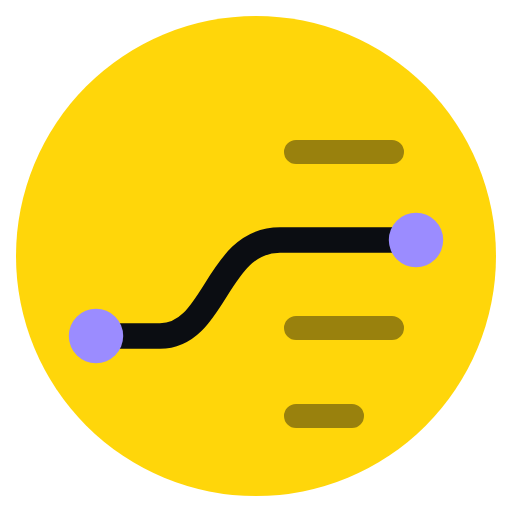
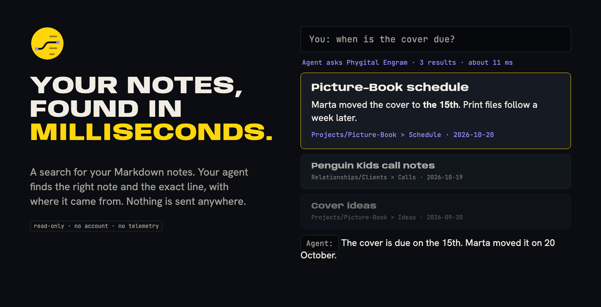
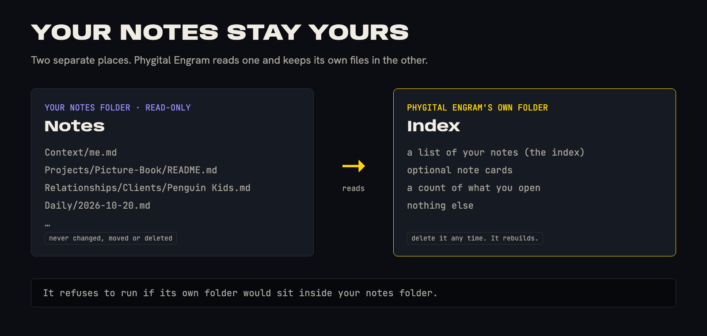
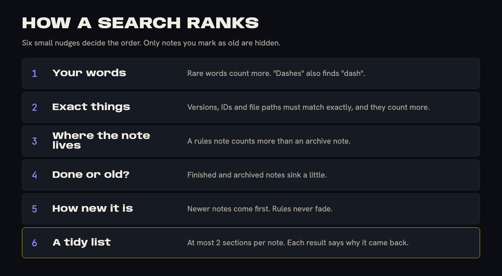

<p align="center"></p>

<h1 align="center">Phygital Engram</h1>

<p align="center"><b>Your notes, found in milliseconds.</b><br>A fast, private search for your Markdown notes. Your agent finds the right note and the exact line, with where it came from. Nothing leaves your computer.</p>

<p align="center">
<a href="#credits"></a>
<a href="LICENSE"></a>
<a href="https://github.com/Phygital-Brain/phygital-engram/stargazers"></a>
<a href="docs/how-it-works.md"></a>
<a href="docs/safety.md"></a>
<a href="docs/privacy.md"></a>
<a href="docs/tools.md"></a>
<a href="docs/benchmarks.md"></a>
</p>
<p align="center">
<a href="https://github.com/Phygital-Brain/phygital-engram/actions/workflows/tests.yml"></a>
<a href="https://github.com/Phygital-Brain/phygital-engram/releases/latest"></a>
<a href="https://github.com/Phygital-Brain/phygital-engram/commits/main"></a>
<a href="docs/roadmap.md"></a>
<a href="https://github.com/Phygital-Brain/phygital-brain"></a>
<a href="CONTRIBUTING.md"></a>
</p>

<p align="center"><b>Free and open source under the Apache-2.0 license.</b> Use it, fork it and change it, share your changes, and keep the credit. See <a href="#credits">Credits</a>.</p>

<p align="center">
<a href="#what-it-is">What it is</a> ·
<a href="#how-fast-is-it">How fast</a> ·
<a href="#quick-start-about-5-minutes">Quick start</a> ·
<a href="docs/connect-your-ai.md">Connect your AI app</a> ·
<a href="#safety-and-privacy">Safety and privacy</a> ·
<a href="docs/examples.md">Things to ask</a> ·
<a href="#works-with-phygital-brain">Phygital Brain</a> ·
<a href="#all-the-guides">All guides</a>
</p>

<details>
<summary><b>Table of contents</b></summary>

- [What it is](#what-it-is)
- [Why it exists](#why-it-exists)
- [Safety and privacy](#safety-and-privacy)
- [How it works, in one picture](#how-it-works-in-one-picture)
- [Words you'll see](#words-youll-see)
- [What you get](#what-you-get)
- [How fast is it?](#how-fast-is-it)
- [Choose how to run it](#choose-how-to-run-it)
- [Quick start (about 5 minutes)](#quick-start-about-5-minutes)
- [Works with Phygital Brain](#works-with-phygital-brain)
- [What it does not do](#what-it-does-not-do)
- [Questions people ask](#questions-people-ask)
- [All the guides](#all-the-guides)
- [Not supported yet](#not-supported-yet)
- [Help and feedback](#help-and-feedback)
- [This repository](#this-repository)
- [Contributors](#contributors)
- [Credits](#credits)
- [No warranty](#no-warranty)
- [License](#license)

</details>

> [!NOTE]
> Works with any folder of Markdown notes, and is made to sit beside [Phygital Brain](https://github.com/Phygital-Brain/phygital-brain). It is not related to other projects that happen to be called Engram.

<p align="center"></p>

## What it is

Phygital Engram is a search for a folder of Markdown notes. Your agent asks it a question, and it returns a short list of the best matches. Each one shows the note, the heading and the date, so you can see where an answer came from.

It only reads your notes. It never writes, moves or deletes one. Its own files live somewhere else, and you can delete them whenever you like.

```
You:   When is the cover due?
Agent: Searching your notes. 3 results, about 11 ms.
       The cover is due on the 15th. Marta moved it on 20 October.
       Source: Projects/Picture-Book > Schedule, 2026-10-20.

You:   And what did we agree on the call?
Agent: The Penguin Kids call note says the print files follow a week later.
       Source: Relationships/Clients > Calls, 2026-10-19.
```

## Why it exists

Once your notes grow past a few hundred files, your agent has bad choices. It can read everything, which is slow and can cost more than it can hold. Or it can guess which files to open, and miss the one that matters.

Pasting everything in does not work either. The AI treats an old note and a new one as equally true, and the more text it reads, the worse and slower its answers get.

Phygital Engram adds a better one: a search that knows your notes. It ranks by your words, and also by where a note lives (a rules file counts more than an old archive), how new it is, and whether it is marked done. The right note comes up first more often, and the answer is short to read.

| Without it | With Phygital Engram |
|---|---|
| Your agent reads hundreds of files to answer one question | It reads a short list, about 1,100 tokens in the author's tests |
| A note from last year ranks the same as today's | Newer notes count more, rule notes never fade |
| An old archive note beats the current one | Archives and finished notes sink a little |
| You can't tell where an answer came from | Every result names its note, heading and date |
| Search sends your notes to a service | Everything stays on your computer |

## Safety and privacy

> [!WARNING]
> The index is made from your notes, so treat it like your notes. It sits in a folder on your computer, and anyone who can read that folder can read what it holds. Read [docs/safety.md](docs/safety.md) before you point it at private folders.

<p align="center"></p>

- **Your notes are read-only.** It never writes, moves or deletes a note. It refuses to start if its own folder would sit inside your notes folder.
- **Secrets are blanked before storing.** Lines like `PASSWORD=`, `TOKEN=` and API keys become `[REDACTED]`. Labelled tax IDs, IBANs and card numbers are blanked too.
- **Password files are never read.** `.env` files, key files and `credentials.json` are skipped.
- **Private folders are locked.** A finance folder can be findable but locked: a match shows only the file name and heading, and the text opens only when you ask.
- **Results are labelled as information.** The text your agent receives is marked as note content, never as instructions.
- **Nothing is collected.** No account, no tracking, no calls to us. The only outside call is the optional note cards, which use your own AI key and only if you turn them on.
- **You can delete the index any time.** It rebuilds from your notes in about 15 seconds for 5,000 notes.
- **Hidden means hidden.** Notes marked `engram: skip`, notes in `.claudeignore` and hidden folders like `.obsidian` and `.git` are never indexed.

More in [docs/safety.md](docs/safety.md) and [docs/privacy.md](docs/privacy.md).

## How it works, in one picture

Phygital Engram builds a small index of your notes, then ranks the matches for each question.

<p align="center"></p>

More in [docs/how-it-works.md](docs/how-it-works.md) and [docs/search-ranking.md](docs/search-ranking.md).

## Words you'll see

| Word | What it means here |
|---|---|
| **Note** | One Markdown file. |
| **Section** | A piece of a note, cut at its headings. Search returns sections. |
| **Index** | The small file Phygital Engram builds from your notes so it can search fast. It lives outside your notes. |
| **Source** | Where an answer came from: the note, the heading and the date. |
| **Ranking** | The order of the results. Words, folder, status and age all count. |
| **Card** | An optional summary an AI writes for each section, to help when you use different words from the note. |
| **Private folder** | A folder that is findable but locked until you ask to open it. |
| **Agent** | The AI app you talk to: Claude, ChatGPT, Codex or another. |
| **MCP** | A plug for AI apps. Phygital Engram includes one, so your agent can search your notes directly. |

## What you get

<p align="center"></p>

- **A ranking tuned for notes.** Rare words count more, word roots match ("dashes" finds "dash"), and exact things like versions, IDs and paths match letter for letter.
- **Folder levels.** Rules and context notes count more. Archives and copied code count less.
- **Age and status.** Newer notes count more, halving every 180 days. Done, closed and archived notes sink. Rules never fade.
- **Folder hints.** Say "decisions" or "daily" in your question and that folder counts double. It is a boost, never a filter.
- **A reason with every result.** A short line says why it came back: "exact match", "decision", "3 months old".
- **Open and look around.** Open one section, or the sections before and after it.
- **A connector for AI apps.** Four read-only tools (`search_notes`, `open_result`, `around_result`, `check_index`) let your agent do all of this itself. A locked private note can be found but never opened by the agent.
- **A health check.** One command says if the index is fresh, if anything private slipped in, and if searches are slow.
- **A test you can run on your own notes.** Write your own questions and score the search.
- **Optional note cards.** An AI writes a card for each section once, using your own key. About $6 for 4,800 notes, then cents a month. See [docs/cards.md](docs/cards.md).

## How fast is it?

<p align="center"></p>

On the author's own notes (about 4,800 files, tested 2026-10-25, before tuning):

| What | Result |
|---|---|
| One search | 9 to 37 ms on a small server, about 11 ms on a laptop |
| Build the index from scratch | about 15 seconds |
| A test copy of 500,000 notes | still answered in 0.23 seconds |
| 104 test questions, without cards | the right note in the top 5 for 90 of 104 |

These are the author's numbers on one set of private notes, so you cannot rerun them. You can rerun a small public version on made-up notes: see [tests/README.md](tests/README.md). The method and the limits are in [docs/benchmarks.md](docs/benchmarks.md).

## Choose how to run it

| Way | Where it runs | Cost | Guide |
|---|---|---|---|
| **1. Your computer, from the command line** | Mac, Windows or Linux with Python | Free | [setup-computer.md](docs/setup-computer.md) |
| **2. Your AI app, through the MCP connector** | Your computer, in Claude Code, Claude Desktop, Codex and others | Free | [connect-your-ai.md](docs/connect-your-ai.md) |
| Claude Desktop extension | Your computer, one click, no config file | Free | [claude-desktop-extension.md](docs/claude-desktop-extension.md) |
| On your own server | A server you run | A few dollars a month | Not written yet |

> [!TIP]
> Not sure? Start with **1**. It is free, and nothing leaves your computer. Using an AI coding agent like Claude Code, Codex or Cursor? Ask it to set this up for you: [AGENTS.md](AGENTS.md) explains the project to it.

## Quick start (about 5 minutes)

> [!IMPORTANT]
> Pre-release. The code arrives with version 0.1.0, and these steps describe that first release. Command names may change before then. Until then, read the guides and watch the repository.

1. Get the program and open a terminal in its folder. See [docs/setup-computer.md](docs/setup-computer.md).

2. Point it at your notes and build the index:

   ```bash
   python3 engram.py ingest
   ```

   You should see a line like `indexed 4774 ... | 15s`.

3. Ask a question:

   ```bash
   python3 engram.py search "when is the cover due"
   ```

   You should see a short list. Each result shows the note, the heading, a snippet and a line saying why it came back.

4. Check it is healthy:

   ```bash
   python3 engram.py health
   ```

   You should see a list of checks with no problems.

5. Connect your AI app. See [docs/connect-your-ai.md](docs/connect-your-ai.md).

6. Ask your agent: *"Search my notes for the Picture-Book schedule and tell me where you found it."*

More in [docs/getting-started.md](docs/getting-started.md).

## Works with Phygital Brain

[Phygital Brain](https://github.com/Phygital-Brain/phygital-brain) builds a folder of notes and keeps it tidy. Phygital Engram searches that folder fast. They are separate on purpose: Phygital Brain stays simple to install, and Phygital Engram works on any Markdown folder, including ones that are not Phygital Brain.

If both are installed, the rules in your brain tell your agent to search first and read files only when the search finds nothing. If Phygital Engram is not installed, nothing breaks: your agent reads files as before.

More in [docs/with-phygital-brain.md](docs/with-phygital-brain.md).

## What it does not do

- **It does not answer.** It finds notes. Your agent reads the result and writes the answer.
- **It does not search by meaning.** It matches words, word roots and exact strings, and uses the folder and age of a note. Optional cards help when you use different words than the note. We tried meaning search: it was about 45 times slower for a small gain. See [docs/limits.md](docs/limits.md).
- **It does not run in the cloud.** It runs on your computer, and there is nothing to sign up for.
- **It does not sync or back up your notes.**
- **It does not read PDFs, images or Word files.** Markdown notes only.

## Questions people ask

<details>
<summary><b>Is it free?</b></summary>

Yes. It is open source under Apache-2.0. The only cost is the optional note cards, which use your own AI key and cost cents after the first run.
</details>

<details>
<summary><b>Does it change my notes?</b></summary>

No. It only reads them. Its own files live in a separate folder, and it refuses to run if that folder would be inside your notes.
</details>

<details>
<summary><b>Does it send my notes anywhere?</b></summary>

No, unless you turn on note cards. Cards send section text to the AI service you choose, with secrets blanked first, and never from a private folder.
</details>

<details>
<summary><b>Do I need Phygital Brain?</b></summary>

No. It works on any folder of Markdown notes, including Obsidian vaults.
</details>

<details>
<summary><b>Why not let my agent read the folder itself?</b></summary>

For a small folder you can. For thousands of notes, reading everything is slow and costs more than it can hold. Search gives your agent the few notes that matter, with their sources.
</details>

<details>
<summary><b>Can I use it from my phone?</b></summary>

Not yet. The connector runs on your computer, and phone apps can only reach one that runs on a server. A server version is on the [roadmap](docs/roadmap.md).
</details>

More in [docs/faq.md](docs/faq.md).

## All the guides

| Guide | Read it when |
|---|---|
| [Getting started](docs/getting-started.md) | You want the shortest path to your first search |
| [Setup on your computer](docs/setup-computer.md) | You want to install and run it, free |
| [Connect your AI app](docs/connect-your-ai.md) | You want your agent to search your notes |
| [Claude Desktop extension](docs/claude-desktop-extension.md) | You use Claude Desktop and want one click |
| [The four tools](docs/tools.md) | You want to know what your agent can do with it |
| [Things to ask](docs/examples.md) | You want ideas for what to ask your agent |
| [The idea behind it](docs/the-idea.md) | You want to know why plain search works for notes |
| [How it works](docs/how-it-works.md) | You want to know what happens inside |
| [How a search ranks](docs/search-ranking.md) | You want to know why a note came first |
| [Every setting](docs/settings.md) | You want to change how it behaves |
| [Note cards](docs/cards.md) | You want to know about the optional AI summaries |
| [Works with Phygital Brain](docs/with-phygital-brain.md) | You use both |
| [Words you'll see](docs/glossary.md) | A term is new to you |
| [Limits](docs/limits.md) | You want to know what it can't do |
| [What we tested](docs/benchmarks.md) | You want the numbers and how they were made |
| [Check the test yourself](tests/README.md) | You want to run the benchmark on made-up notes |
| [Safety](docs/safety.md) | Before you point it at private folders |
| [Privacy](docs/privacy.md) | You want to know what is kept and where |
| [Updates](docs/updates.md) | You want the newest version |
| [Questions people ask](docs/faq.md) | You have a quick question |
| [Troubleshooting](docs/troubleshooting.md) | Something doesn't work |
| [Roadmap](docs/roadmap.md) | You want to know what is planned |
| [SECURITY.md](SECURITY.md) | You found a security problem |
| [CHANGELOG.md](CHANGELOG.md) | You want to know what changed in each version |
| [CONTRIBUTING.md](CONTRIBUTING.md) | You want to report a bug or send a fix |
| [CONTRIBUTORS.md](CONTRIBUTORS.md) | You want to see who helped, or be added |
| [GOVERNANCE.md](GOVERNANCE.md) | You want to know how decisions are made |
| [SUPPORT.md](SUPPORT.md) | You need help and don't know where to ask |
| [AGENTS.md](AGENTS.md) | You (or your AI coding agent) want to change the code or set it up |
| [TRADEMARKS.md](TRADEMARKS.md) | You want to use the name or logo |
| [.env.example](.env.example) | You want every setting in one file |

## Not supported yet

- **The Claude website and phone app, and ChatGPT.** They need a connector that runs on a server over HTTPS. This one runs on your computer.
- **Tested inside AI apps.** The connector was tested by running its four tools against the sample notes. It has not been tested inside Claude Code, Claude Desktop, Codex, Cursor, VS Code or Gemini CLI yet.
- **Meaning search.** Matching by meaning needs an AI model at search time. In our test it made searches about 45 times slower for a small gain.
- **Other languages.** Word roots are tuned for English. Other languages work for plain word matches only.
- **Windows and Linux checks.** It was tested on macOS only so far.
- **Files other than Markdown.** PDFs, images and Word files are not read.

## Help and feedback

| You want to | Go to |
|---|---|
| Fix a problem yourself | [Troubleshooting](docs/troubleshooting.md) |
| Report a bug | [Something doesn't work](https://github.com/Phygital-Brain/phygital-engram/issues/new?template=bug_report.yml) |
| Ask a question or share an idea | [Question or idea](https://github.com/Phygital-Brain/phygital-engram/issues/new?template=question.yml) |
| Report a security problem, privately | [Private report](https://github.com/Phygital-Brain/phygital-engram/security/advisories/new) ([SECURITY.md](SECURITY.md)) |

Issues are public, so leave out passwords, keys and private notes.

## This repository

| Path | What is in it |
|---|---|
| `mcp/` | The connector that lets an AI app search your notes. Four read-only tools |
| `.claude-plugin/`, `glama.json` | The Claude Code plugin and the MCP directory listing |
| `docs/` | Every guide, and the images they use |
| `tests/` | A made-up sample of 24 notes and 26 questions, so you can run the benchmark yourself |
| `.github/` | Issue forms, the pull request checklist and the automatic checks |
| `scripts/` | `check.py`, which checks links, headings and style before every change, and `build_mcpb.py`, which builds the Claude Desktop extension |
| `AGENTS.md` | A guide for AI coding agents that change this repository |
| `NOTICE`, `LICENSE`, `TRADEMARKS.md` | The license, the credits and the name and logo rules |

The search code (`engram.py` and `engram_lib/`) arrives with version 0.1.0, after tuning.

## Contributors

Thank you to everyone who helped. Code, bug reports, ideas, docs and design all count. See [CONTRIBUTORS.md](CONTRIBUTORS.md), and add yourself when you send a pull request.

## Credits

Phygital Engram was made by [Phygital-Brain](https://github.com/Phygital-Brain), next to [Phygital Brain](https://github.com/Phygital-Brain/phygital-brain). It is not related to other projects that happen to be called Engram.

You are welcome to use, fork, change and build on it under the Apache License 2.0 and the notices in [NOTICE](NOTICE). In short:

- Keep [LICENSE](LICENSE), [NOTICE](NOTICE) and the copyright lines.
- Say where it came from. See [TRADEMARKS.md](TRADEMARKS.md) for the words to use.
- Mark your version as changed if you changed it.

GitHub's "Cite this repository" button uses [CITATION.cff](CITATION.cff).

## No warranty

Phygital Engram is free software you run yourself. It comes as is, with no warranty: you use it at your own risk, and no author is responsible for lost or damaged data (the [license](LICENSE) says so in full). It never changes your notes, but keep a backup of them anyway.

## License

[Apache License 2.0](LICENSE), with the notices in [NOTICE](NOTICE). Copyright (C) 2026 Phygital-Brain and Phygital Engram contributors.
