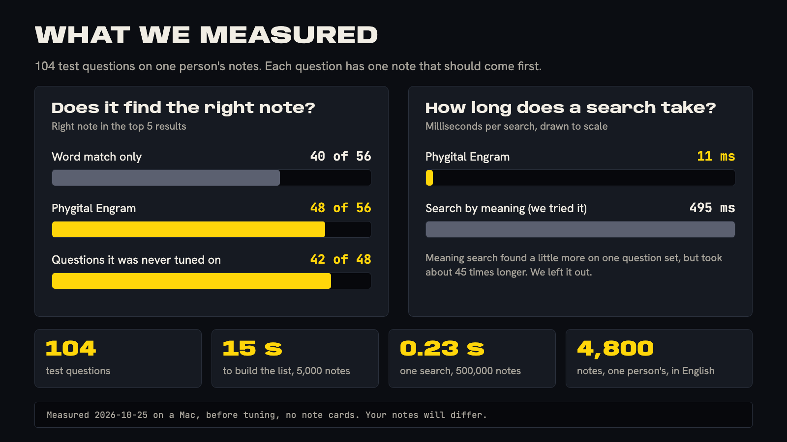

# What we tested

These are the numbers behind the claims, how they were made, and what we did not test.

> [!WARNING]
> These numbers are a snapshot of the working version, measured before more tuning. They come from about 4,800 English notes by one person. They show what we saw, and your notes may differ. Every number will be measured again before version 0.1.0.

<p align="center"></p>

<details>
<summary><b>Table of contents</b></summary>

- [The setup](#the-setup)
- [Speed](#speed)
- [Does it find the right note?](#does-it-find-the-right-note)
- [A small comparison with GBrain](#a-small-comparison-with-gbrain)
- [Search by meaning: tried, left out](#search-by-meaning-tried-left-out)
- [Sourced facts: promising, not in 0.1.0](#sourced-facts-promising-not-in-010)
- [What was not tested](#what-was-not-tested)
- [Test your own notes](#test-your-own-notes)

</details>

## The setup

| Thing | Value |
|---|---|
| Date | 2026-10-25 |
| Computer | A Mac, macOS, Python 3.15.0, SQLite 3.54.1 |
| Notes | A copy of 4,971 Markdown notes from the author's notes folder. The private finance folder was left out of the copy |
| Note cards | Off. The local test had none, so these numbers are lower than the live setup, which has cards |
| Version | The working version, before tuning. Not a release |

## Speed

| What | Result |
|---|---|
| Search on the laptop copy, per question | About 11 milliseconds (10 to 13 across runs) |
| Search on the author's server, 10 test questions | 9 to 37 milliseconds. Door to door, 80 to 107 milliseconds |
| Building the index from scratch, about 5,000 notes | About 6 seconds on the laptop copy. About 15 seconds on the server |
| A 500,000-note test copy | A search answered in 0.23 seconds |
| Results text per question | About 1,100 tokens. Without a search, the same questions match about 104 notes, roughly 237,000 tokens |

## Does it find the right note?

**Method.** We wrote 104 questions, each with the note that should come up. We used 56 while tuning and kept 48 hidden, never tuned on. The questions come in five kinds: facts, exact strings (versions, IDs, file names), paraphrases (different words than the note), decisions, and rules that never fade. A question is a hit if the right note is in the top 1, 5 or 10.

| Set | Right note first | In the top 5 | In the top 10 | Average position score (MRR) |
|---|---|---|---|---|
| Tuning, 56 questions | 30 | 48 | 51 | 0.663 |
| Hidden, 48 questions | 29 | 42 | 45 | 0.729 |

For comparison, plain word matching with none of the extra signals found the right note first in 29 of 56 tuning questions and in the top 5 in 40. The extra signals (folder levels, newness, status, exact strings) moved the top 5 from 40 to 48 of 56.

By kind, on the 56 tuning questions, right note in the top 5:

| Kind | Hits |
|---|---|
| Facts | 12 of 12 |
| Paraphrases | 15 of 17 |
| Decisions | 9 of 11 |
| Rules that never fade | 6 of 8 |
| Exact strings | 6 of 8 |

The 8 misses were spread across kinds. They happened where a question used very different words than the note.

## A small comparison with GBrain

[GBrain](https://github.com/garrytan/gbrain) is another open-source tool that searches notes for AI agents. It is MIT-licensed and does more than we do (a link map, saved facts with their sources, search by meaning). We ran both on the same small sample.

| Thing | Value |
|---|---|
| Notes | About 99 sample notes copied from the author's folder, no private or client notes |
| Questions | 10, written by hand, each with a known note |
| Phygital Engram | Without cards. The right note first on 9 of 10. One miss was a note that the author's own settings hide on purpose |
| GBrain | Word search plus meaning search, with a small local model. The right note first on 7 of 10, in the top 3 on 10 of 10 |
| Time | About 2 ms against about 540 ms including start-up of its command line |

> [!NOTE]
> This is a small test. Ten questions cannot show which tool is better in general, and the sample was repetitive. GBrain also skipped 15 of the 99 notes, because it treats a folder named `Skills` specially. We did not test GBrain's written answers with sources, or GBrain with cards. The result holds only for this small test.

## Search by meaning: tried, left out

We added search by meaning to a copy of the working version. A small local model turned each section into numbers, and the closest sections were blended with the normal results. We ran the same 104 questions.

| Blend | Hidden set, top 5 | Hidden set, right note first | Time per search |
|---|---|---|---|
| Without meaning search | 42 | 29 | About 11 ms |
| Light blend | 44 | 31 | About 495 ms |
| Heavy blend | 36 | 28 | About 493 ms |

The light blend helped a little on the hidden set. On the tuning set the top-5 count did not change, so the gain could be luck. It was about 45 times slower. The heavy blend made things worse. We left meaning search out because the gain was small and the cost was large. Note cards cover part of the same gap without slowing a search down. See [limits](limits.md) and [cards](cards.md).

## Sourced facts: promising, not in 0.1.0

We tried returning the single line that answers, with its note, heading and date, instead of whole sections. It used plain word matching only, with no AI.

On the 55 questions where the answer was already in the first 3 sections:

| Measure | Result |
|---|---|
| The first fact line holds the answer | 28 of 55 |
| One of the first 3 lines holds it | 40 of 55 |
| Text to read per question | About 1,000 characters instead of about 3,100 |
| Facts that carry note, heading and date | All of them |

This is a simple first version. It is not in the working release yet. See the [roadmap](roadmap.md).

## What was not tested

- Other people's notes, in other folder layouts.
- Other languages. All the test notes are in English.
- Phones, Windows and Linux. The tests ran on one Mac.
- The server version (`mcp/serve.py`). 11 automated tests pass and Claude Code connected to it over HTTP. The login page also worked in a browser, on a desktop and a phone-sized screen. Docker, Compose, Caddy, a real server, a real phone, the Claude website and ChatGPT were not tested with this repository. No audit has been done.
- A big comparison with other tools. Only the small one above.
- The AI connector (MCP) in most apps. It worked in Claude Code on the sample notes. It was not tried in Claude Desktop, Codex, Cursor, VS Code or Gemini CLI.
- Long-term use: what happens after months of "learning from use".
- Security audits. None has been done: see [safety](safety.md).

## Test your own notes

Want to rerun a small public version first? The folder [tests/](../tests/README.md) holds 24 made-up notes and 26 questions, with the result we got.

You can score your own setup. Write a file of questions, each with the note that should come first. It looks roughly like this:

```json
[
  {
    "q": "when is the cover due?",
    "expect_files": ["Projects/Picture-Book/README.md"],
    "expect": ["cover due on the 15th"],
    "kind": "fact"
  }
]
```

`expect_files` is the note that should come up. `expect` is a phrase it should contain. Then run the test command:

```bash
python3 engram.py test
```

You should see how many questions had the right note first, in the top 5 and in the top 10, and the time per question. File names and command names may change before 0.1.0: see [settings](settings.md).
