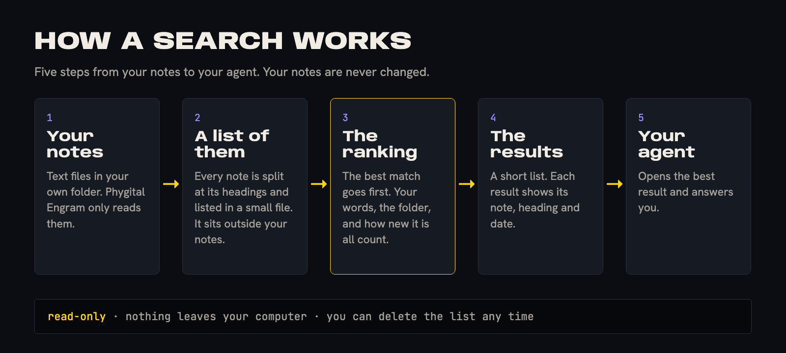

# Getting started

Search your own Markdown notes in about 10 minutes. By the end you have asked a question and opened the answer.

> [!NOTE]
> This page matches version 0.2.0. The search program is in this repository.

## What you need

- **A folder of Markdown notes.** Plain `.md` files, in subfolders if you like. Obsidian vaults, Baalda folders and [Phygital Brain](with-phygital-brain.md) brains all work.
- **A file named `CLAUDE.md` at the top of that folder.** It can be empty. The search checks for it before it indexes, so it never builds an index from a half-copied folder. Phygital Brain makes this file for you. If your folder has none, create an empty one. Without it, indexing stops and nothing changes.
- **A second folder for the index**, outside your notes. It keeps its own files there.
- **Python** on your computer. [Set up on your computer](setup-computer.md) shows how to install it.
- **About 5 minutes of patience** the first time, while the index is built. After that it is quick.

You don't need an AI account, an API key or a server. You don't need to know any code.

## The path in one picture



## 1. Point it at your notes folder

Phygital Engram needs to know where your notes are. One setting tells it. Use the folder your notes live in.

```bash
export ENGRAM_VAULT="$HOME/Notes"
```

You should see nothing. The setting lasts only for this terminal window. [Settings](settings.md) shows how to keep it.

Phygital Engram only reads your notes. It keeps its own files in a separate folder. See [Safety](safety.md).

## 2. Build the index

The index is a small file that lets Phygital Engram look things up fast. You build it once, and it updates itself after that.

```bash
python3 engram.py ingest
```

You should see a line like `indexed 4971, unchanged 0, removed 0 ... | 5200 sections | 6.1s`. For about 5,000 notes this took seconds on a laptop. It is safe to run again at any time.

## 3. Ask your first question

Ask the way you would ask a person.

```bash
python3 engram.py search "when is the cover for the penguin book due"
```

You should see a short list. Each result has a number, the note's path, the heading it came from, and a piece of the text with your words marked. A line starting with `why:` says why the result ranked high, for example "your words in the heading" or "from today". The last line shows how long the search took in milliseconds.

## 4. Open a result

Take the number at the start of the best result, like `#1204`, and open it.

```bash
python3 engram.py get 1204
```

You should see the full section. Add `--note` to see the whole note. To see what sits before and after it, and notes from the same day, use this:

```bash
python3 engram.py around 1204
```

Every result names its note, heading and date. Use them to check an answer before you trust it.

## 5. Check it is healthy

```bash
python3 engram.py health
```

You should see a list of checks, each marked OK. A problem is written in plain words with what to do. See [Troubleshooting](troubleshooting.md) if one is not OK.

## Or use the search page

Prefer a page to the terminal? Run this and your browser opens a small page on your own computer, with the same search, a look at your notes, and the health check:

```bash
python3 engram.py page
```

See [The search page](search-page.md).

## What next

- Learn what to ask in [Examples](examples.md).
- See what decides the order of results in [How results are ranked](search-ranking.md).
- Use it from your AI agent. The repository has a connector. It worked in Claude Code and has not been tried in other apps yet. For your phone, the Claude website or ChatGPT, use the server version: [Setup on your own server](setup-own-server.md). See also [Connect your AI](connect-your-ai.md) and [Tools](tools.md).
- Something unclear? Look in the [FAQ](faq.md) or the [glossary](glossary.md).
