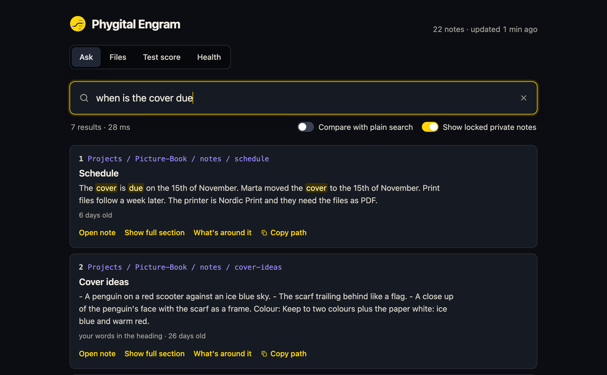

# The search page

A small page on your own computer where you ask your notes a question, read the answer, and check the index. It is the same search your AI agent uses.

<p align="center"></p>

## Open it

```bash
python3 engram.py page
```

Your browser opens at `http://127.0.0.1:8787`. Press Control and C in the terminal to stop it. Build the index first if you have not: see [getting-started.md](getting-started.md).

## What is on it

- **Ask.** Type a question. Each result shows its note, the matched words highlighted, why it came back, and links to open the note, show the full section, see what is around it and copy its path. **Compare with plain search** shows what a word-only search would have found.
- **Files.** A read-only view of your notes, folder by folder. Nothing here can change a note.
- **Test score.** Runs your own test questions and shows how many land in the top 1, 5 and 10. See [benchmarks.md](benchmarks.md#test-your-own-notes).
- **Health.** The same checks as `python3 engram.py health`, and a button to update the index.

A link like `http://127.0.0.1:8787/?q=cover+due` opens the page with that question already asked.

## What it does and does not do

- **Only this computer can reach it.** It listens on `127.0.0.1`. It checks the address of every request, so a web page on another site cannot use it to read your notes.
- **It loads nothing from the internet.** No fonts, no scripts, no images, no tracking. The page and its one library, `marked` (to show Markdown), are files in this repository.
- **It never changes your notes.** It has no way to write to them.
- **Secret files stay shut.** Files such as `.env` and keys are listed so you know they exist, and their contents are never shown. Private folders open only after you confirm.
- **It follows your computer's appearance.** Dark is the default, and light follows your system setting.

## Settings

The port and the browser opening are in [settings.md](settings.md#the-search-page).

## If it does not open

- **"Already running."** A page is open already. The command opens it again.
- **The port is taken.** Set another with `ENGRAM_PAGE_PORT=8800 python3 engram.py page`.
- **"Nothing found" for everything.** The index is empty: run `python3 engram.py ingest`.

## What we tested

| What | Result |
|---|---|
| 7 automated tests: the page answers only itself, loads nothing outside, cannot leave the notes folder, never shows a secret file, keeps private notes locked and never changes a note, 2026-10-25 | Pass |
| The page in a real browser on the made-up sample notes, in dark mode, 2026-10-25 | Worked |
| Light mode, a phone-sized screen, Windows and Linux | Not tested yet |
